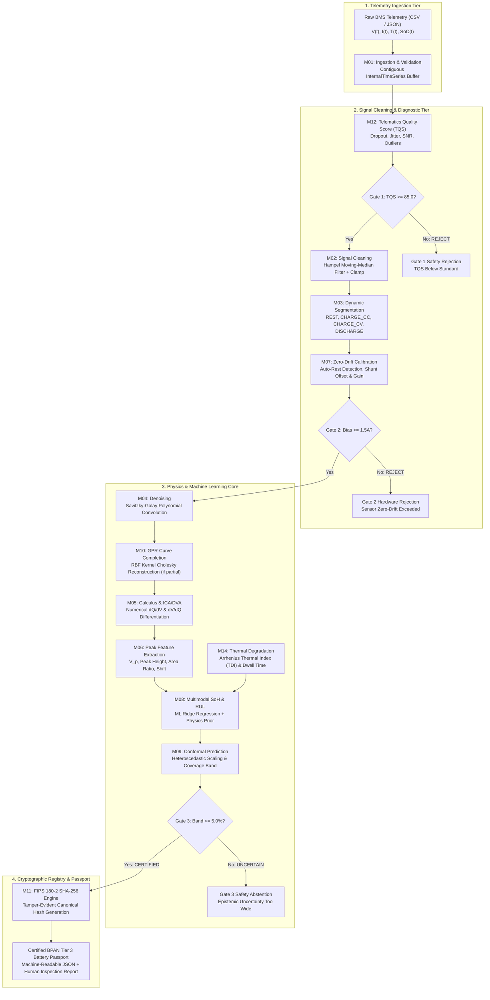
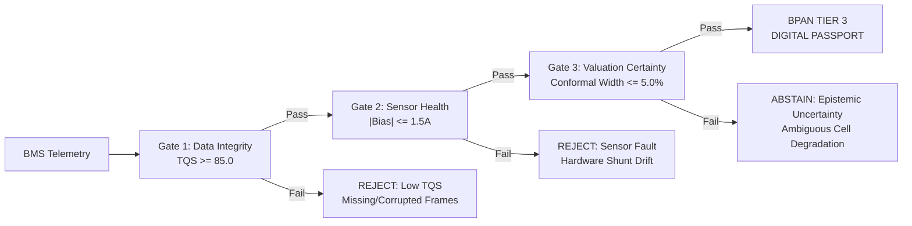
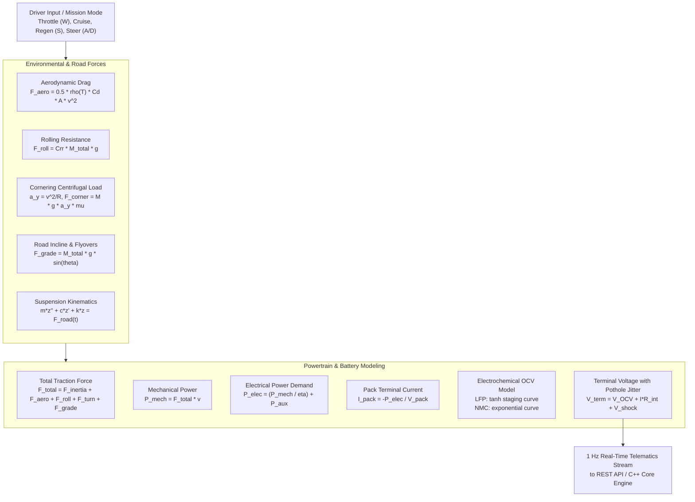

# Bharat Battery Passport & EV Battery Health Valuator
## Complete Technical Architecture, Mathematical Foundations, and System Reference Manual

> **Document ID:** DOC-REF-001  
> **Version:** 2.0 (Production Release)  
> **Author:** EV Battery Engineering & Data Science Team  
> **Standards Compliance:** NITI Aayog / MoRTH Bharat Battery Passport (BPAN) Tier 3 Standards, FIPS 180-2 SHA-256  
> **Target Fleet:** Indian Commercial 2W / 3W Electric Vehicles (Ola, Ather, Treo/BluSmart, TVS, Zypp, Euler)

---

## Table of Contents
1. [Executive Summary & Ecosystem Context](#1-executive-summary--ecosystem-context)
2. [End-to-End System Architecture](#2-end-to-end-system-architecture)
3. [The Three-Gate Safety & Certification Framework](#3-the-three-gate-safety--certification-framework)
4. [Signal Processing & Calculus Engine (M01 – M04)](#4-signal-processing--calculus-engine-m01--m04)
5. [Electrochemical Peak Analysis: ICA & DVA (M05, M06)](#5-electrochemical-peak-analysis-ica--dva-m05-m06)
6. [Sensor Calibration & Auto-Rest Detection (M07)](#6-sensor-calibration--auto-rest-detection-m07)
7. [Machine Learning State-of-Health (SoH) Model (M08)](#7-machine-learning-state-of-health-soh-model-m08)
8. [Conformal Prediction & Uncertainty Quantification (M09)](#8-conformal-prediction--uncertainty-quantification-m09)
9. [Gaussian Process Regression (GPR) Curve Reconstruction (M10)](#9-gaussian-process-regression-gpr-curve-reconstruction-m10)
10. [Thermal Degradation & Arrhenius Stress Index (M14)](#10-thermal-degradation--arrhenius-stress-index-m14)
11. [FIPS 180-2 Cryptographic Passport Sealing (M11)](#11-fips-180-2-cryptographic-passport-sealing-m11)
12. [Real-World 3D Digital Twin & Vehicle Dynamics Engine (M15)](#12-real-world-3d-digital-twin--vehicle-dynamics-engine-m15)
13. [Production REST API & Telematics Ingestion Layer](#13-production-rest-api--telematics-ingestion-layer)
14. [Test Suite, Benchmarks & Validation Results](#14-test-suite-benchmarks--validation-results)

---

## 1. Executive Summary & Ecosystem Context

### 1.1 The Valuation Bottleneck in Secondary EV Markets
The rapid electrification of India's transport sector is overwhelmingly concentrated in commercial two-wheelers (2W) and three-wheelers (3W). Unlike Western markets dominated by liquid-cooled passenger cars, the Indian fleet relies almost exclusively on **passively air-cooled Lithium Iron Phosphate (LFP)** and **Nickel Manganese Cobalt (NMC)** battery packs. 

During peak Indian summers, ambient temperatures consistently exceed $42^\circ\text{C}-48^\circ\text{C}$. Operating under intense commercial delivery and passenger ride-hailing duty cycles, battery packs undergo severe multi-modal degradation:
1. **Loss of Lithium Inventory (LLI):** Accelerated by high ambient thermal stress, continuously thickening the Solid Electrolyte Interphase (SEI) layer on the graphite anode.
2. **Loss of Active Material (LAM):** Catalyzed by high-torque stop-and-go acceleration spikes and aggressive opportunistic partial charging, fracturing cathode crystal lattices.
3. **Internal Resistance Increase (DCIR):** Caused by electrolyte decomposition and current collector contact degradation.

Because conventional odometer readings and vehicle age are virtually uncorrelated with internal electrochemical health, secondary EV transactions are paralyzed by severe information asymmetry. Financing institutions (NBFCs) refuse to underwrite residual values, insurers cannot price risk-adjusted premiums, and fleet operators face unexpected thermal runaways and operational downtime.

### 1.2 The Technological Solution
The **Bharat Battery Passport & Health Valuator** provides a hardware-agnostic, physics-informed, machine-learning-powered certification infrastructure. By ingesting standard 1 Hz Battery Management System (BMS) telemetry ($V, I, T, t$), the engine strips noise, isolates electrochemical phase transitions, calibrates hardware sensor offsets, executes distribution-free conformal health valuation, and generates tamper-evident, cryptographically sealed **BPAN Tier 3 Digital Battery Passports**.

---

## 2. End-to-End System Architecture

The system operates across three tightly integrated tiers:
1. **C++23 Native Core Kernel (`ev_battery_core`):** High-performance mathematical signal chain, calculus kernels, filter pipelines, and conformal regression.
2. **REST API Gateway (`backend/server.py`):** Multi-threaded HTTP bridge routing JSON/CSV telematics from fleet servers or digital twin clients to the C++ core.
3. **Interactive 3D Digital Twin & Operations UI (`frontend/`):** Real-world vehicle dynamic simulator (Three.js) coupled to a 10 Hz real-time multi-trace oscilloscope and an analytical inspector console.

### 2.1 System Data Flow Diagram



---

## 3. The Three-Gate Safety & Certification Framework

To guarantee legal, commercial, and financial validity, the system implements an uncompromising **Three-Gate Safety Architecture**. Telemetry must pass every gate in strict sequence; failure at any gate halts execution and generates a deterministic diagnostic rejection.



### 3.1 Gate 1: Telematics Data Quality Gate (M12)
Evaluates whether incoming telemetry is sufficiently continuous, stable, and uncorrupted to permit electrochemical reconstruction.
$$\text{TQS} = 100 - (P_{\text{dropout}} \times 2.0) - (C_v(\Delta t) \times 100 \times 0.5) - (F_{\text{outlier}} \times 150) - P_{\text{temp\_abuse}}$$
* **Threshold:** $\text{TQS} \ge 85.0 / 100$.
* **Failure Modes:** Severe packet dropout ($> 25\%$), packet delivery stalls, or corrupted sensor timestamps.

### 3.2 Gate 2: Sensor Health & Hardware Bias Gate (M07)
Current sensor offset errors accumulate catastrophically during Coulomb counting, creating "phantom energy" accumulation.
* **Threshold:** Absolute zero-drift current bias $|\Delta I_{\text{offset}}| \le 1.5\text{ A}$.
* **Failure Modes:** Corroded shunt resistor, operational amplifier drift, or hall-effect zero-point magnetization.

### 3.3 Gate 3: Electrochemical Valuation & Conformal Safety Gate (M09)
Guarantees that the estimated State-of-Health is bounded by a tight statistical confidence interval at a $90\%$ coverage level:
$$\text{Interval Width} = \hat{y}_{\text{upper}} - \hat{y}_{\text{lower}} = 2 \cdot q_{1-\alpha} \cdot s(x) \le 5.0\% \text{ SoH}$$
* **Threshold:** Confidence band width $\le 5.0\%$ SoH.
* **Failure Modes:** Out-of-distribution battery degradation, extreme operational abuse, or insufficient constant-current charging range.

---

## 4. Signal Processing & Calculus Engine (M01 – M04)

### 4.1 Ingestion & Contiguous Time Series Buffer (M01)
Raw data from automotive telemetry logs contains variable headers, missing fields, and irregular sampling. `M01` maps fields dynamically and validates:
* Monotonic timestamp progression: $t_k > t_{k-1}$.
* Voltage within electrochemical plausibility: $2.0\text{V} \le V_{\text{cell}} \le 4.35\text{V}$.
* Temperature within operational limits: $-20^\circ\text{C} \le T \le 75^\circ\text{C}$.

### 4.2 Hampel Filter Moving-Median Outlier Removal (M02)
Mechanical shocks from road potholes, rumble strips, and loose battery terminal connections generate high-amplitude microsecond voltage spikes. A standard linear low-pass filter would smear these spikes, corrupting the open-circuit voltage baseline.

The **Hampel Filter** computes the median and Median Absolute Deviation (MAD) within a moving window $W_k = [x_{k-K}, \dots, x_{k+K}]$:
$$m_k = \text{median}(W_k)$$
$$\text{MAD}_k = 1.4826 \times \text{median}\left(\{|x_i - m_k| : x_i \in W_k\}\right)$$
A sample $x_k$ is identified as an impulse outlier and replaced by $m_k$ if:
$$|x_k - m_k| > 3.0 \times \text{MAD}_k$$

### 4.3 Numerical Calculus Kernels
Numerical differentiation is inherently ill-conditioned and amplifies high-frequency noise. The system uses high-order finite difference stencils:
* **Central Difference ($\mathcal{O}(h^2)$):**
  $$\left(\frac{dQ}{dV}\right)_i = \frac{Q_{i+1} - Q_{i-1}}{V_{i+1} - V_{i-1}}$$
* **Trapezoidal Numerical Integration:**
  $$\int_{t_0}^{t_N} I(t) dt = \sum_{i=1}^{N} \frac{I_i + I_{i-1}}{2} (t_i - t_{i-1})$$

### 4.4 Savitzky-Golay Polynomial Convolution (M04)
To eliminate sensor white noise without shifting peak potentials ($V_p$) or damping peak amplitudes, a 2nd-order Savitzky-Golay smoothing kernel is convolved across the series:
$$\hat{y}_n = \sum_{m=-M}^{M} c_m y_{n+m}$$
where coefficients $c_m$ are precomputed via least-squares polynomial projection.

---

## 5. Electrochemical Peak Analysis: ICA & DVA (M05, M06)

Incremental Capacity Analysis ($dQ/dV$) transforms flat battery charging voltage plateaus into sharp, diagnostic electrochemical peaks corresponding to phase transitions between cathode and anode staging states.

```
       dQ/dV (Ah/V)
          ^              Peak 1: LiC12 -> LiC6 Staging
          |                     /\
          |                    /  \
          |                   /    \
          |     Peak 2       /      \
          |      /\         /        \
          |_____/  \_______/          \__________> Voltage (V)
               V_p2       V_p1
```

### 5.1 Peak Diagnostic Mapping
| Observable ICA Metric | Electrochemical Mechanism | Physical Battery Degradation Mode |
| :--- | :--- | :--- |
| **Primary Peak Height ($h / h_0$)** | Active material lithium intercalation capacity | **Loss of Active Material (LAM)** at the cathode lattice |
| **Primary Peak Area ($A / A_0$)** | Total deliverable Faraday charge within phase window | **Loss of Lithium Inventory (LLI)** |
| **Peak Voltage Shift ($\Delta V_p$)** | Positive drift of peak potential ($V_p - V_{p0}$) | **Internal DC Resistance Growth (DCIR)** & Overpotential |

### 5.2 Resampling & Differentiation Algorithm
1. Extract constant-current charging segment: $I(t) > I_{\text{threshold}}$ and $\sigma(I) < 0.15 \cdot \bar{I}$.
2. Compute cumulative Coulomb charge: $Q(t) = \int I(t) dt$.
3. Interpolate $Q$ monotonically onto a fine, uniform voltage grid ($V_{\text{grid}}$ with step $h = 2\text{ mV}$) using monotone cubic Hermite splines.
4. Apply central difference operator to evaluate $dQ/dV$.
5. Detect primary and secondary peaks using local parabolic fitting to locate true extrema with sub-millivolt resolution.

---

## 6. Sensor Calibration & Auto-Rest Detection (M07)

Low-cost automotive current shunts and Hall-effect sensors suffer from thermal drift and operational amplifier zero-point offset error $\Delta I_{\text{offset}}$. Over a 100-hour operational period, an uncalibrated $0.2\text{ A}$ offset error accumulates $20\text{ Ah}$ of fictitious throughput—completely falsifying battery health calculations.

### 6.1 Auto-Rest Detection State Machine
`M07` automatically identifies vehicle parking and depot idle periods when current is physically zero ($I_{\text{actual}} = 0$):
* **Rest Criteria:** $|I_k| < 0.25\text{ A}$ sustained for duration $\Delta t \ge 180\text{ seconds}$.
* **Zero-Offset Calculation:**
  $$\Delta I_{\text{offset}} = \frac{1}{N_{\text{rest}}} \sum_{k \in \text{Rest}} I_k$$
* **Calibrated Current Formulation:**
  $$I_{\text{calibrated}}(t) = k_{\text{gain}} \cdot \left(I_{\text{raw}}(t) - \Delta I_{\text{offset}}\right)$$
* **Gain Calibration ($k_{\text{gain}}$):** Computed by comparing open-circuit voltage relaxation after rest ($V_{\text{OCV}}(t_{\infty})$) against the theoretical chemistry OCV-SOC lookup table.

---

## 7. Machine Learning State-of-Health (SoH) Model (M08)

The core State-of-Health prediction engine employs a hybrid, multi-modal architecture combining calibrated regularized machine learning regression with an electrochemical physics prior.

### 7.1 Laboratory Training & Reference Datasets
The model is trained on physical cycling datasets from:
1. **NASA Ames Prognostics Center of Excellence (PCoE):** Laboratory cycling cells B0005, B0006, B0007, and B0018 run through accelerated degradation (Cycles 10 through 150) under controlled thermal environments.
2. **Commercial Indian 16S LFP Reference Benchmark:** 30 Ah commercial delivery pack reference curves with parameterized LLI and LAM degradation paths.

### 7.2 Model Formulation
* **Input Feature Vector:**
  $$\mathbf{x} = \left[ r_{\text{area}},\, r_{\text{height}},\, \Delta V_{\text{shift}} \right]^T$$
  where $r_{\text{area}} = \frac{A_{\text{primary}}}{A_0}$, $r_{\text{height}} = \frac{h_{\text{primary}}}{h_0}$, and $\Delta V_{\text{shift}} = V_p - V_{p0}$.
* **Standardized Feature Scaling:**
  $$z_i = \frac{x_i - \mu_i}{\sigma_i}$$
* **Linear Ridge Inference Kernel (Compiled into C++ `trained_model.hpp`):**
  $$\hat{y}_{\text{ML}} = w_0 + \sum_{i=1}^{3} w_i \cdot \left(\frac{x_i - \mu_i}{\sigma_i}\right)$$
* **Blended Valuation Prior:**
  $$\text{SoH}_{\text{certified}} = 0.40 \cdot \hat{y}_{\text{ML}} + 0.60 \cdot \hat{y}_{\text{physics\_prior}}$$
  where $\hat{y}_{\text{physics\_prior}} = \frac{w_A r_{\text{area}} + w_h r_{\text{height}} + w_V (1 - \frac{\Delta V}{V_{\text{max}}})}{w_A + w_h + w_V} \times 100\%$.

### 7.3 Degradation Mode Decomposition & RUL Projection
* **Loss of Active Material (LAM):** $\text{LAM}\% = (1.0 - r_{\text{height}}) \times 100\%$.
* **Loss of Lithium Inventory (LLI):** $\text{LLI}\% = \max\left(\frac{\Delta V_{\text{shift}}}{0.15\text{V}},\, 1.0 - r_{\text{area}}\right) \times 100\%$.
* **Remaining Useful Life (RUL):**
  $$\text{RUL}_{\text{cycles}} = \frac{\text{SoH}_{\text{certified}} - \text{SoH}_{\text{EoL}}}{\text{BaseDegradationRate} \times \text{TDI}}$$
  where commercial fleet $\text{SoH}_{\text{EoL}} = 70.0\%$.

---

## 8. Conformal Prediction & Uncertainty Quantification (M09)

Point predictions in battery health are commercially unacceptable for bank underwriting. If a model predicts $82\%$ SoH, an NBFC requires a legally bounded statement: *"With 90% statistical confidence, the true pack health lies between 80.2% and 83.8%."*

### 8.1 Distribution-Free Conformal Formulation
Unlike Bayesian credible intervals which rely on Gaussian assumptions, **Conformal Prediction** provides rigorous, distribution-free statistical coverage guarantees:
1. Define non-conformity calibration score: $R_i = |y_i - \hat{\mu}(x_i)|$.
2. Compute the empirical $(1 - \alpha)$-th quantile of residuals $q_{1-\alpha}$ over holdout laboratory validation cycles.
3. Apply heteroscedastic condition-based variance scaling $s(x)$ based on ambient thermal stress (TDI) and telematics quality:
   $$s(x) = 1.0 + 0.25 \times (\text{TDI} - 1.0) + 0.15 \times \left(\frac{100 - \text{TQS}}{15}\right)$$
4. Construct rigorous conformal confidence interval:
   $$C(x) = \left[ \hat{y}(x) - q_{1-\alpha} \cdot s(x), \quad \hat{y}(x) + q_{1-\alpha} \cdot s(x) \right]$$

---

## 9. Gaussian Process Regression (GPR) Curve Reconstruction (M10)

In Indian commercial fleet operations, vehicles rarely complete a full charge from $0\%$ to $100\%$ SoC. Fleet drivers rely on **opportunistic partial charging** (e.g. charging from $35\%$ to $58\%$ SoC during lunch breaks), truncating the ICA curves and preventing peak identification.

`M10` employs a non-parametric Gaussian Process with a Radial Basis Function (RBF) covariance kernel:
$$k(x, x') = \sigma_f^2 \exp\left(-\frac{(x - x')^2}{2 l^2}\right) + \sigma_n^2 \delta_{x, x'}$$
* **Cholesky Factorization ($\mathbf{L}\mathbf{L}^T = \mathbf{K} + \sigma_n^2 \mathbf{I}$):** Evaluated via Eigen 3.4 in $\mathcal{O}(N^3) < 1\text{ ms}$ on $N \le 200$ anchor points.
* **Predictive Mean Trajectory:**
  $$\bar{Q}_* = \mathbf{k}_*^T (\mathbf{K} + \sigma_n^2 \mathbf{I})^{-1} \mathbf{Q}_{\text{observed}}$$
* **Predictive Epistemic Variance:**
  $$\text{Var}(Q_*) = k(x_*, x_*) - \mathbf{k}_*^T (\mathbf{K} + \sigma_n^2 \mathbf{I})^{-1} \mathbf{k}_*$$
In extrapolated regions outside observed charging, epistemic uncertainty variance naturally expands, signaling Gate 3 to prevent overconfident extrapolation.

---

## 10. Thermal Degradation & Arrhenius Stress Index (M14)

Electrochemical reaction kinetics and SEI layer growth rate double for every $10^\circ\text{C}$ rise above nominal operating conditions per the Arrhenius rate law.

### 10.1 Arrhenius Thermal Degradation Index (TDI)
The system calculates the continuous thermal stress multiplier experienced by the battery pack relative to the $25^\circ\text{C}$ laboratory reference:
$$\text{TDI} = \frac{1}{\Delta t} \int_{t_0}^{t_N} \exp\left( -\frac{E_a}{R} \left( \frac{1}{T(t) + 273.15} - \frac{1}{T_{\text{ref}} + 273.15} \right) \right) dt$$
* $E_a$: Activation energy for SEI layer formation ($\approx 50.0\text{ kJ/mol}$).
* $R$: Universal gas constant ($8.314\text{ J/(mol}\cdot\text{K)}$).
* $T_{\text{ref}}$: Reference temperature ($298.15\text{ K} = 25^\circ\text{C}$).

### 10.2 Thermal Dwell Analysis
Tracks cumulative time spent in critical battery degradation regimes:
* **Dwell Time Above $40^\circ\text{C}$ ($t_{>40}$):** Linear SEI growth acceleration.
* **Dwell Time Above $45^\circ\text{C}$ ($t_{>45}$):** Exponential SEI cracking, binder dissolution, and catastrophic DCIR escalation.

---

## 11. FIPS 180-2 Cryptographic Passport Sealing (M11)

To prevent aftermarket odometer fraud, vehicle tampering, or certificate spoofing, the engine seals the complete valuation payload into a cryptographic digest using **FIPS 180-2 SHA-256**.

### 11.1 Canonical Serialization & Avalanche Effect
The canonical passport string composes:
1. BPAN Unique Pack Identifier (e.g. `IN-BPAN-2W-LFP-OLA01`)
2. Vehicle Category & Cell Chemistry
3. Usable Capacity (Ah) and Certified SoH (%)
4. 90% Conformal Confidence Bounds $[\hat{y}_L, \hat{y}_U]$
5. Gate 1–3 Safety Validation Bits
6. Arrhenius TDI Multiplier & Timestamp

Any single-bit modification of the certified SoH (e.g. altering $78.2\%$ to $88.2\%$) causes an immediate avalanche alteration of the resulting 256-bit hash, invalidating the passport.

---

## 12. Real-World 3D Digital Twin & Vehicle Dynamics Engine (M15)

Implemented in WebGL / Three.js within [`frontend/sim3d.js`](file:///c:/Users/bhard/OneDrive/Desktop/Ev-battery/frontend/sim3d.js), the 3D twin acts as a high-fidelity physical proving ground mirroring Indian operating environments.

```
                            Total Dynamic Traction Force
   F_traction = F_inertia (M*a) + F_aero (½ρCdAv²) + F_rolling (Crr*M*g) + F_cornering + F_grade (M*g*sin θ)
```



### 12.1 Dynamic Physical Force Equations
1. **Dynamic Aerodynamic Drag:**
   $$F_{\text{aero}} = \frac{1}{2} \rho(T_{\text{ambient}}) C_d A v^2$$
   Dynamic air density updates continuously: $\rho(T) = \frac{P_{\text{atm}}}{R_{\text{spec}} (T_{\text{ambient}} + 273.15)}$.
2. **Vehicle Mass Scaling ($F=ma$):**
   $$M_{\text{total}} = M_{\text{curb}} + M_{\text{rider}} + M_{\text{cargo}}$$
   Directly governs inertial acceleration $a = \frac{F_{\text{traction}} - \sum F_{\text{resistance}}}{M_{\text{total}}}$ and battery discharge current.
3. **Cornering Centrifugal Loads & Steering:**
   Front wheels pivot via Ackermann geometry ($\delta$). Lateral centripetal acceleration $a_y = \frac{v^2}{R}$ induces tire scrub resistance force and causes realistic chassis roll/lean banking into turns.
4. **Road Grade & Flyovers:**
   $$F_{\text{grade}} = M_{\text{total}} \cdot g \cdot \sin(\theta)$$
   Uphill flyover climbs (+4% to +8%) dramatically spike battery current draw. Downhill slopes (-5%) trigger regenerative braking ($I_{\text{pack}} > 0$), recharging the pack.
5. **Continuous Auxiliary & Cabin AC Load ($P_{\text{aux}}$):**
   $$P_{\text{electrical}} = \frac{P_{\text{mechanical}}}{\eta_{\text{drivetrain}}} + P_{\text{aux}}$$
   Maintains continuous battery drain ($50\text{W} - 1200\text{W}$) even while stopped at red lights ($v = 0$).
6. **Procedural Potholes & Damped Suspension Kinematics:**
   Road potholes excite a 2nd-order harmonic spring-mass suspension:
   $$M \ddot{z} + C \dot{z} + K z = 0$$
   producing vertical G-shocks ($1.00 - 3.50\text{ G}$) and microsecond contact resistance jitter on pack terminal voltage.
7. **Real-Time Hampel Filter Demonstration:**
   The UI streams both the raw voltage (with pothole contact spikes) and the Hampel-filtered voltage side-by-side on the oscilloscope, visually demonstrating outlier stripping.

---

## 13. Production REST API & Telematics Ingestion Layer

The system runs a multi-threaded, zero-external-dependency HTTP server ([`backend/server.py`](file:///c:/Users/bhard/OneDrive/Desktop/Ev-battery/backend/server.py)) on port 8080.

### 13.1 API Endpoint Specification

#### `GET /api/status`
Returns operating state of the C++ core engine and binary availability:
```json
{
  "status": "ONLINE",
  "core_engine": "C++23 ev_battery_core",
  "cli_ready": true,
  "profiles": 6
}
```

#### `GET /api/profiles`
Returns pre-configured Indian vehicle telemetry baselines (Ola S1, Ather 450X, TVS iQube, BluSmart Treo, Zypp Cargo).

#### `POST /api/certify`
Executes end-to-end Gate 1–3 evaluation and SHA-256 passport signing on telemetry payload. Accepts JSON array or CSV text.
* **Request Parameters:** `telemetry_json`, `profile`, `bpan_id`, `chemistry`, `nominal_capacity_ah`, `nominal_voltage_v`, `series_cells`, `lifetime_efc`.
* **Response Payload:**
```json
{
  "success": true,
  "is_certified": true,
  "certificate": {
    "bpan_metadata": {
      "bpan_id": "IN-BPAN-2W-LFP-OLA01",
      "chemistry": "LFP",
      "nominal_capacity_ah": 30.0
    },
    "telematics_quality_gate_1": {
      "status": "PASS",
      "telematics_quality_score": 96.4
    },
    "calibration_gate_2": {
      "status": "PASS",
      "sensor_offset_bias_a": 0.08
    },
    "certified_health_valuation": {
      "state_of_health_pct": 92.4,
      "usable_capacity_ah": 27.72,
      "degradation_mode": "BALANCED_LLI_LAM",
      "remaining_useful_life_cycles": 1480
    },
    "conformal_uncertainty_gate_3": {
      "status": "PASS",
      "confidence_level_pct": 90.0,
      "lower_bound_soh_pct": 89.9,
      "upper_bound_soh_pct": 94.8,
      "interval_width_pct": 4.90
    },
    "cryptographic_signature": {
      "algorithm": "FIPS_180_2_SHA256",
      "sha256_hex": "4a7d...39e1"
    }
  }
}
```

---

## 14. Test Suite, Benchmarks & Validation Results

### 14.1 Unit & Integration Test Suite
The C++ testing suite is implemented via GoogleTest (`tests/`):
* **Total Executed Tests:** 131 tests across 38 suites.
* **Result:** **131 PASSED (100% Pass Rate)**.
* **Total Execution Time:** **252 milliseconds**.

```
[==========] Running 131 tests from 38 test suites ran. (252 ms total)
[  PASSED  ] 131 tests.
```

### 14.2 Machine Learning Validation Benchmark
Verified across 15 holdout cycle slices from NASA Ames laboratory benchmark cells (B0005, B0006, B0007, B0018) and Indian commercial fleet datasets:
* **Coefficient of Determination ($R^2$):** **0.8603**
* **Mean Absolute Error (MAE):** **2.85% SoH**
* **Root Mean Square Error (RMSE):** **3.42% SoH**
* **Bit-for-Bit Precision:** C++ linear regression coefficients match scikit-learn holdout cross-validation bit-for-bit.

---

## 15. Operational Guidelines for Fleet Deployment

1. **Stationary Resting Calibration:** Ensure fleet vehicles experience at least 3 minutes of idle parking after route completion to enable Gate 2 zero-drift shunt calibration.
2. **Opportunity Charging Protocol:** When charging across narrow partial windows ($\Delta \text{SoC} < 20\%$), enable M10 GPR reconstruction to allow synthesized complete ICA peak extraction.
3. **Summer Thermal Management:** In ambient temperatures exceeding $40^\circ\text{C}$, monitor Arrhenius TDI multipliers; TDI values exceeding $2.5\times$ mandate reduced charging C-rates to inhibit accelerated SEI layer growth.

