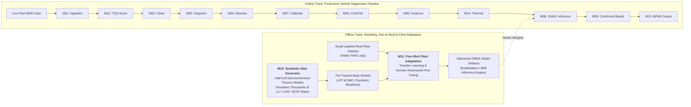
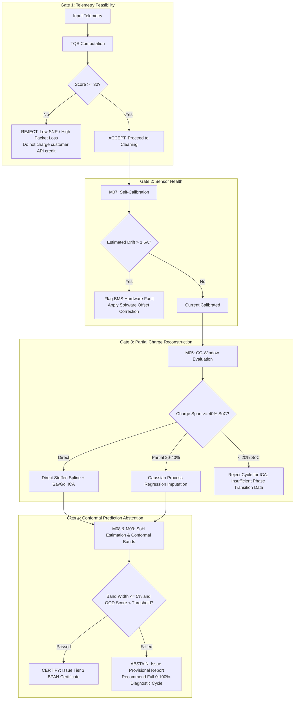

# EV Battery Telemetry Analyzer & SoH Certification Engine
## Feature Execution Order and End-to-End Pipeline Architecture

> **Document ID:** FLOW-001  
> **Version:** 1.0  
> **Created:** 2026-10-03  
> **Status:** Active  
> **Target Architecture:** Indian 2W/3W Passive-Cooled Fleet Ecosystem (LFP/NMC) & BPAN Tier 3

---

## 1. Executive Summary & Flow Philosophy

The EV Battery Telemetry Analyzer processes raw, noisy, irregular BMS telemetry streams from commercial Indian 2-wheeler and 3-wheeler fleets (last-mile delivery, ride-hailing). Due to low-cost current sensors (shunt/Hall-effect drift), passive air cooling under extreme ambient temperatures (>45°C), and erratic partial-charge cycles, execution order is paramount to ensure mathematical integrity before electrochemical feature extraction and ML inference.

---

## 2. High-Level System Execution Flowchart

```mermaid
flowchart TD
    classDef ingestion fill:#1e293b,stroke:#38bdf8,stroke-width:2px,color:#f8fafc;
    classDef preprocessing fill:#1e293b,stroke:#818cf8,stroke-width:2px,color:#f8fafc;
    classDef calib fill:#1e293b,stroke:#fbbf24,stroke-width:2px,color:#f8fafc;
    classDef ica fill:#1e293b,stroke:#34d399,stroke-width:2px,color:#f8fafc;
    classDef ml fill:#1e293b,stroke:#f472b6,stroke-width:2px,color:#f8fafc;
    classDef out fill:#1e293b,stroke:#4ade80,stroke-width:2px,color:#f8fafc;
    classDef reject fill:#450a0a,stroke:#f87171,stroke-width:2px,color:#fecaca;

    RawData[Raw Fleet Telemetry<br/>JSON / CSV / MQTT Stream]:::ingestion
    --> M01[Step 1: Data Ingestion & Schema Normalization<br/><b>M01: ingestion</b>]:::ingestion

    M01 --> M12[Step 2: Telemetry Quality Scoring<br/><b>M12: quality_score</b>]:::preprocessing

    M12 --> CheckQ{TQS Quality<br/>Check >= 30?}
    CheckQ -- No: Reject --> TermReject[Reject Log & Flag Anomaly<br/>Emit Diagnostics Alert]:::reject
    CheckQ -- Yes: Pass --> M02[Step 3: Signal Cleaning & Anomaly Filtering<br/><b>M02: cleaning</b>]:::preprocessing

    M02 --> M03[Step 4: Operational Segmentation<br/><b>M03: segmentation</b>]:::preprocessing

    M03 --> SplitRegime{Segment Type}
    SplitRegime -- Rest Segments --> RestAnchor[Rest Voltage & OCV Anchors]:::calib
    SplitRegime -- Drive / Discharge --> ThermalAnalysis[Thermal Stress Tracking<br/><b>M14: thermal</b>]:::preprocessing
    SplitRegime -- Charge Segments --> M04[Step 5: Denoising & Smoothing<br/><b>M04: denoising</b>]:::preprocessing

    RestAnchor --> M07[Step 6: Current-Sensor Self-Calibration<br/><b>M07: calibration</b><br/>Offset & Gain Error Estimation]:::calib
    M04 --> M07

    M07 --> CalibratedCharge[Calibrated Voltage & Ah Stream<br/>Drift-Corrected Coulomb Integral]:::calib

    CalibratedCharge --> CC_Check{Constant-Current<br/>Window >= 20% SoC?}
    CC_Check -- Partial / Gaps --> GPR[GPR Curve Reconstruction<br/>Missing Interval Completion]:::ica
    CC_Check -- Complete --> M05[Step 7: ICA / DVA Transformation<br/><b>M05: ica_dva</b><br/>dQ/dV & dV/dQ via SavGol / Steffen Spline]:::ica
    GPR --> M05

    M05 --> M06[Step 8: Electrochemical Feature Extraction<br/><b>M06: features</b><br/>Peak Tracking: Vp, hp, Ap, Valley Shifts]:::ica

    M06 --> FeatureVector[Assembled Multi-Modal Feature Vector<br/>Electrochemical + Thermal + Age + Mileage]:::ml
    ThermalAnalysis --> FeatureVector

    FeatureVector --> M08[Step 9: State-of-Health & RUL Estimation<br/><b>M08: estimation</b><br/>Pre-Trained ONNX / Gradient Boosting]:::ml

    M08 --> M09[Step 10: Uncertainty Quantification<br/><b>M09: uncertainty</b><br/>Conformal Prediction: 90% Confidence Band]:::ml

    M09 --> ConfCheck{Confidence Interval<br/>Band <= 5%?}
    ConfCheck -- High Uncertainty --> AbstainedReport[Flag for Physical Audit / Recalibration]:::reject
    ConfCheck -- Certified --> M13[Step 11: Certification & BPAN Payload<br/><b>M13: output</b><br/>Battery Pack Aadhaar Tier 3 Dynamic Data]:::out

    M13 --> FinalCert[Signed Health Certificate<br/>JSON / PDF & Cloud BPAN Dispatch]:::out
```



---

## 3. Detailed Step-by-Step Feature Execution Pipeline

Below is the definitive sequence of execution for all 15 system modules, explaining inputs, algorithms, outputs, and mathematical dependencies.

| Sequence # | Feature / Module | Module ID | Primary Operations & Algorithms | Input Data | Output Data | Failure / Branching Behavior |
|:---:|:---|:---:|:---|:---|:---|:---|
| **0** | **Math Utilities Kernel** | `M15` | Savitzky-Golay QR filter, Steffen monotone spline, Kahan stats, numerical differentiation, trapz integration | Vector / span buffers | Computational routines | Zero allocation on hot path |
| **1** | **Ingestion & Normalization** | `M01` | OEM payload parsing, Unix timestamp normalization, unit conversions (mV→V, mA→A, d°C→°C) | Raw JSON / CSV / MQTT payloads | `InternalTimeSeries` containing standardized `Sample` arrays | Rejects malformed JSON; logs invalid sensor flags |
| **2** | **Telemetry Quality Scoring (TQS)** | `M12` | Sampling jitter detection, packet dropout %, SNR estimation, temperature sensor plausibility check | `InternalTimeSeries` | Score $\in [0, 100]$ & `QualityLabel` (EXCELLENT, ACCEPTABLE, MARGINAL, REJECT) | If score $< 30$, halts pipeline and marks session REJECT |
| **3** | **Signal Cleaning** | `M02` | Hampel filter (outlier rejection), timestamp monotonicity enforcement, stuck-sensor detection | Cleaned time series | Outlier-free voltage, current, and temperature vectors | Drops corrupt packets, marks interpolated gaps |
| **4** | **Regime Segmentation** | `M03` | Threshold hysteresis & state machine: CHARGE ($I > I_{min}$), DISCHARGE ($I < -I_{min}$), REST ($\|I\| \le I_{threshold}$) | Continuous clean time series | Segmented windows with CC-charging windows isolated | Discards sub-50s micro-fragments |
| **5** | **Signal Denoising** | `M04` | Centered Moving Average, Savitzky-Golay polynomial smoothing ($W=15, P=3$), Adaptive 1D Kalman Filter | Raw charge segment voltage $V(t)$ | Denoised monotonic $V_{smooth}(t)$ | Falls back to moving median if spikes detected |
| **6** | **Current-Sensor Self-Calibration** | `M07` | Overlapping charge segment consistency, rest OCV anchor matching, closed-loop offset $\alpha$ & gain $\beta$ regression | Segmented charge + rest OCV anchors | Calibrated current $I_{corr} = (I - \alpha) / \beta$ and drift-corrected $Q(t) = \int I_{corr} dt$ | If residual $> 2\%$, raises sensor degraded alert |
| **7** | **ICA / DVA Transformation** | `M05` | Steffen monotonic cubic interpolation ($Q(V)$ grid), Savitzky-Golay numerical derivative ($dQ/dV$), Gaussian Process Regression (GPR) | Calibrated $(V, Q)$ pairs | Differential capacity curve $dQ/dV(V)$ and differential voltage $dV/dQ(Q)$ | If charge window $< 20\%$ SoC, activates GPR extrapolation |
| **8** | **Electrochemical Feature Extraction** | `M06` | Peak picking via first/second derivative zero-crossings, peak height ($h_1, h_2$), peak location ($V_{p1}, V_{p2}$), peak area ($A_{p1}$), valley shifts | Smooth $dQ/dV$ curves | High-dimensional degradation feature vector $\mathbf{x}_{feat}$ | If expected LFP peak missing, flags severe LAM |
| **9** | **Thermal Stress Modeling** | `M14` | Arrhenius cumulative aging integration, time above 40°C/45°C thermal penalty factor, $\Delta T$ rise rate during CC | Temperature time series $T(t)$, current $I(t)$ | Thermal Degradation Index (TDI) & Arrhenius equivalent cycle multiplier | Feeds thermal penalty into SoH estimator |
| **10** | **SoH & RUL Estimation** | `M08` | ONNX Runtime inference using trained LightGBM / Random Forest / Multi-Layer Perceptron models | Feature vector $\mathbf{x}_{feat} + \text{TDI} + \text{Mileage}$ | Point estimates: $\widehat{\text{SoH}} \in [0, 100]\%$, Remaining Useful Life (cycles) | Verifies bounds $[0, 120\%]$ |
| **11** | **Uncertainty & Abstention** | `M09` | Split conformal prediction bands, 90% and 95% coverage intervals, out-of-distribution (OOD) distance metric | Point estimates + validation non-conformity scores | Confidence interval $[\text{SoH}_{low}, \text{SoH}_{high}]$ & Abstention flag | If confidence interval width $> 5\%$, pipeline marks "AUDIT_REQUIRED" |
| **12** | **Certification & BPAN Dispatch** | `M13` | Battery Pack Aadhaar Number (BPAN) Tier 3 JSON serialization, SHA-256 cryptographic digest, PDF certificate generation | Certified SoH, confidence bands, thermal score, BPAN ID | Final signed Health Certificate & MoRTH API payload | Dispatched to registry / client dashboard |

---

## 4. Dual-Track Execution: Offline Development vs. Online Runtime



---

## 5. Decision & Quality Gates (Fallback Logic)

At key junctions in the telemetry processing sequence, automated gates safeguard against invalid outputs:



---

## 6. Implementation Iteration Roadmap

The software features are delivered across 11 structured iterations in accordance with [rules.md](file:///c:/Users/bhard/OneDrive/Desktop/Ev-battery/docs/rules.md):

```mermaid
gantt
    title Module Delivery Roadmap
    dateFormat  YYYY-MM-DD
    section Foundation
    Iteration 0: Scaffolding, Build, Math Utils (M15)     :done,    it0, 2026-10-01, 2026-10-03
    section Signal Processing
    Iteration 1: Cleaning, Segment, Denoise (M02, M03, M04) :active,  it1, 2026-10-04, 2026-10-10
    Iteration 2: ICA/DVA Engine & Features (M05, M06)      :         it2, 2026-10-11, 2026-10-17
    Iteration 3: Ingestion & Quality Scoring (M01, M12)     :         it3, 2026-10-18, 2026-10-24
    section Advanced Estimation & Calibration
    Iteration 4: Current-Sensor Self-Calibration (M07)     :         it4, 2026-10-25, 2026-10-31
    Iteration 5: SoH Estimation Model (M08)                 :         it5, 2026-11-01, 2026-11-07
    Iteration 6: Uncertainty & Conformal Prediction (M09)   :         it6, 2026-11-08, 2026-11-14
    section Physics, Adaptation & Compliance
    Iteration 7: Synthetic Sim-to-Real Data (M10)          :         it7, 2026-11-15, 2026-11-21
    Iteration 8: Thermal Model & BPAN Certificates (M14, M13):       it8, 2026-11-22, 2026-11-28
    Iteration 9: Few-Shot Fleet Adaptation (M11)           :         it9, 2026-11-29, 2026-12-05
    Iteration 10: Full Pipeline Integration & Hardening     :         it10, 2026-12-06, 2026-12-15
```

---

## 7. Data Contract Interfaces Summary

```
[Raw Payload (JSON/CSV)]
         │
         ▼
[InternalTimeSeries (Sample: t, V, I, T, [Cell_V])]
         │
         ▼
[CleanTimeSeries & QualityScore (0-100)]
         │
         ▼
[SegmentList (Charge, Discharge, Rest)]
         │
         ▼
[CalibratedChargeSegment (I_corr, Q_integral)]
         │
         ▼
[DifferentialCapacityCurve (V, dQ/dV, dV/dQ)]
         │
         ▼
[DegradationFeatureVector (Vp, hp, Ap, Valley_shift, ThermalIndex)]
         │
         ▼
[SoHReport (SoH_pct, RUL_cycles, [Conf_low, Conf_high], IsAbstained)]
         │
         ▼
[BPAN Certification Payload (BPAN-ID, Dynamic Data Tier 3, Signed Hash)]
```
